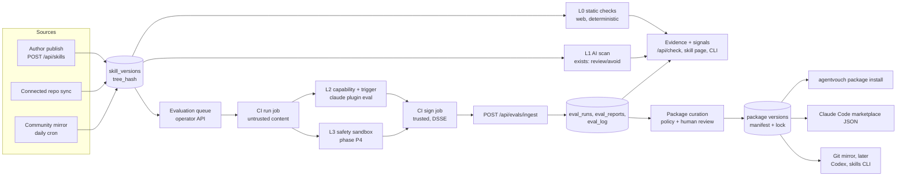
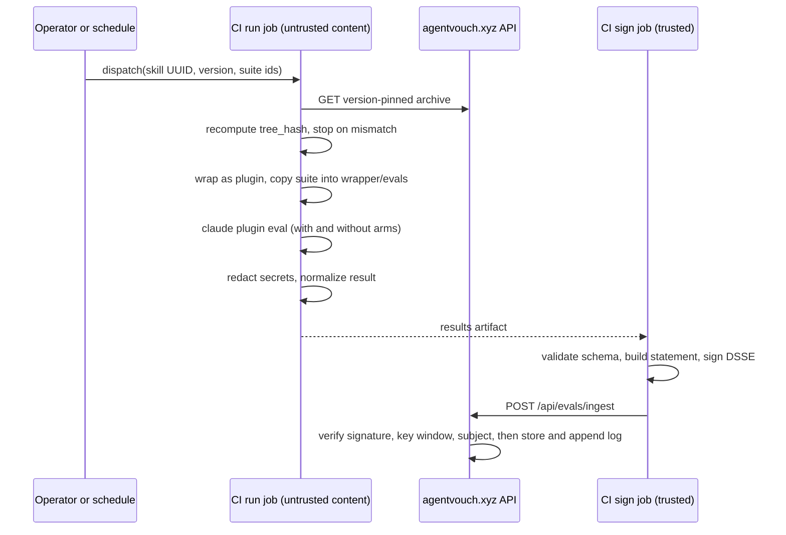

# Skill Evaluations and Skill Packages

<!-- plain-language-reading-guide: 2026-10-24 -->

> **Start with the plain-language guide:** [What we are building, money limits, and launch steps](../../docs/PLAIN_LANGUAGE_GUIDE.md).
>
> Status: draft architecture for owner review, written 2026-10-24 against `main` at `dfc5fff5`.
> This plan does not approve implementation, deployment, trust-rule changes, new dependencies, or model spending.
> No code was changed and no checks were run while writing it. The repository facts below come from reading the code.

## Summary

AgentVouch tells an agent two things about a skill today:

- **Who stands behind it.** Stake, vouches, author bond, and Reports.
- **What an automated reviewer thinks of its text.** The advisory scan returns `review` or `avoid`.

AgentVouch cannot yet answer three questions:

1. Does this skill make an agent better at the task it claims?
2. What does the skill do when an agent runs it with real tools?
3. Is the file that I installed the same file that was checked?

This plan adds that evidence. Each result applies to one exact skill version (its tree hash). Each result is signed and public. **Evidence never grants `allow`.** Only staked trust can grant `allow`. That is the current rule, and this plan keeps it.

The plan then uses the evidence to make **skill packages**. A package is a small, versioned bundle of related skills that passed a written policy. A person or agent installs a package with one command. The install checks every file hash. AgentVouch can withdraw ("yank") a package version when new evidence shows a problem.

## Goal

- Give agents version-pinned, reproducible, signed evidence about what a skill does and whether it helps.
- Make installs verifiable from download to disk.
- Publish curated packages of related, reputable skills through the channels agents already use.
- Keep the work additive, off the Base launch path, and inside the current trust rules until the owner approves a change.

## Why now (checked 2026-10-24)

- **Attacks on skill registries are real and current.** A Cloud Security Alliance note (2026-07-07) summarizes ClawHub findings: Koi Security found 341 malicious skills in 2,857 (February 2026), then 824 in more than 10,700. Unit 42 found a skill padded to about 22 MB to pass scanner limits, and skills with no malware at all that steered the agent during the task (affiliate injection, front-running).
- **Most bad skills use prompt injection.** Snyk's ToxicSkills study (2026-02-05) scanned 3,984 skills: 13.4% had a critical issue, 76 were confirmed malicious, and 91% of the malicious ones used prompt injection.
- **Skills can make agents worse.** SkillsBench (arXiv 2602.12670, NeurIPS 2026) ran 84 tasks with and without skills. Curated skills raised pass rates by about 12 to 16 points on average (the paper reports both numbers), but 16 of 84 tasks got worse (worst case −39.3 points). Self-written skills gave no gain. Two or three skills worked best. The agent harness changed results.
- **Standard tools now exist.** `claude plugin eval` (Claude Code v2.1.269 or later) runs each case with and without a plugin and writes a versioned JSON result. NVIDIA publishes SkillEvaluator (Apache-2.0) and signed skills with skill cards. Claude Code marketplaces support commit pins, archive SHA-256 pins, and delisting.
- **No one ties this evidence to stake.** Scanners and signatures show "unchanged" and "no known bad pattern". They do not show "helps" or "behaves safely with tools", and nothing is at risk when they are wrong. The roadmap says AgentVouch should be "the trust layer they query, not a competing storefront" (`docs/ROADMAP.md`, Known risks). This plan is a direct step toward that.

## Current state (read in the repo, 2026-10-24)

| Piece | Where | What it gives | Limit found |
| --- | --- | --- | --- |
| Content-addressed versions | `web/lib/db.ts` (`skill_versions.files`, `tree_hash`, `has_executable`); `web/lib/skillStorage.ts` (`computeTreeHash`) | One stable identity per version | No written spec for other clients |
| Advisory AI scan | `web/lib/ai/scan.ts` (rubric `v1`); `skill_scans` keyed by `(tree_hash, rubric_version, model)` | `review` or `avoid` from the text | Reads text only. Input is capped at 512 KB, so large trees are truncated (`truncated=true`) |
| Capability summary | `web/lib/ai/summarize.ts` | One-line summary and capability phrases | Describes. Does not measure |
| Scanner eval harness | `evals/skill-scan/` (25 cases; north star is unsafe recall) | Measures the scanner | Not evidence about a specific skill |
| Trust signals | `web/lib/trustSignals.ts` (`ai_scan`, `vouched`, `author_bonded`, `registered`, `dispute_free`; `fuseActions`) | A checklist and one rollup action; the scan never grants `allow` | No signal about skill behavior |
| Community mirror | `web/lib/mirror/{sources,sync,github}.ts`; sources `anthropics/skills` and `openai/skills`; daily cron 07:00 UTC | Free, attributed mirror listings | Commit SHA is resolved per sync but not stored per version. License file must be inside the skill folder; a repo-root license is ignored |
| CLI install | `packages/agentvouch-cli/src/lib/{install,metadata}.ts` | Writes `<path>.agentvouch.json` with `tree_hash` | Does not recompute or compare the hash after download |
| Downloads | `/api/skills/{id}/raw`, `/archive`, `/zip` | Current version only | No version-pinned read. `buildZipArchive` sorts with `localeCompare`, which depends on ICU data, so zip bytes are not a safe long-term pin |
| Operator auth | `/api/cron/*` with Bearer `CRON_SECRET` | Pattern for operator-only routes | — |

## Scope

### In scope

- A written tree-hash spec, CLI hash verification, and version-pinned reads.
- Deterministic static checks over the full skill tree.
- Capability and trigger evaluations run by AgentVouch in CI, with signed reports and public read APIs.
- Display of evidence on the skill page, in `/api/check`, and in the CLI. Display only.
- Design of safety evaluations and packages (each needs its own plan before build).
- Mirror provenance (commit SHA, path) and better license detection.

### Out of scope

- Any change to the Solana program or the Base contracts.
- Economics, floors, splits, vouch rules, curator stake, or paid packages.
- Any real-money flow, including paid evaluation requests.
- Base mainnet (`eip155:8453`) or anything else gated by `docs/MAINNET_READINESS.md`.
- Evaluation of paid skills (needs an author opt-in design).
- Private customer suites and runtime enforcement (`docs/ROADMAP.md`, "Enterprise workflow validation"). They can reuse this runner and report format later under their own plan.
- Changes to `recommended_action` (phase P5, ask first).

## Architecture

### Principles

1. **Evidence, not authority.** Scans and evaluations can lower trust. They never grant `allow`. Staked trust stays the only path to `allow` (`scan.ts` rule, `fuseActions`).
2. **One version, one subject.** Every result names one `tree_hash`. A new version starts with no evaluation evidence.
3. **Reuse open formats.** Agent Skills spec for skills. `claude plugin eval` layout for cases. in-toto Statement in a DSSE envelope for signed reports. Claude Code marketplace JSON for distribution.
4. **Fail closed on integrity.** A hash mismatch stops the install.
5. **Run untrusted content only in a disposable sandbox with no real secrets.**
6. **Public by default.** Public cases, results, and log. Only holdout cases stay private, and their hashes are public.
7. **Minimal and additive.** New tables, routes, CLI commands, and CI jobs. Existing behavior does not change until the owner approves.
8. **Say what a result does not prove.** Every report carries a limitations statement.

### Component view



### Evidence layers

| Layer | What it answers | Runs where | Cost | Output | Status |
| --- | --- | --- | --- | --- | --- |
| L0 static checks | Is the tree well formed? Does it hide text or tell the agent to fetch and run remote code? | Web, deterministic, full tree | Near zero | Findings list | New (P1) |
| L1 advisory AI scan | Does the text show concrete risk? | Web, one budgeted model call | Low | `review` or `avoid` | Exists |
| L2 capability and trigger evaluation | Does the skill help? Does it fire only when it should? | CI runner | Medium | WITH, W/OUT, Δ, trigger precision and recall | New (P2) |
| L3 safety evaluation | What does it do with real tools, secrets, and network? | CI sandbox | Medium | Deterministic violations | New (P4) |
| L4 people | Who will put money or reputation behind it? | Vouches, Reports, curator review | — | Stake, disputes, review notes | Vouches and Reports exist; curator review is new (P3) |

L0 is cheap and sees the whole tree, so it covers the part of a large tree that L1 truncates.

### Subject identity and integrity

- **`tree_hash` (existing).** For each file: `path + "\0" + hex(sha256(bytes))`. Sort the entries. Join them with `"\n"`. Take the SHA-256 of the result. The spec must state three details that the code implies:
  - Sort order is JavaScript default string order (UTF-16 code units). This is the same as byte order for ASCII paths. The spec must keep this order so existing hashes stay valid.
  - Paths are hashed as stored, with no Unicode normalization. The spec should recommend NFC paths for new uploads and say what happens to non-NFC paths.
  - The single-file backfill in `db.ts` uses the same formula, so legacy rows are compatible.
- **`archive_sha256` (new, packages).** SHA-256 of the package archive bytes. AgentVouch builds each archive once at publish time and stores the bytes in Blob. It never rebuilds an archive on request.
- **`upstream` (new).** `{ repo, commit_sha, path }` for mirrored and reference-mode content. The runner recomputes the tree hash from upstream at `commit_sha` and compares it with the stored `tree_hash`.
- **Content-addressed lookups.** `/api/check` with local content can return evidence when the content's tree hash matches a known version.

### Evaluation suites

**Formats**

- **Primary: the `claude plugin eval` case layout** (`schema_version: "1.1"`). Each case is a folder with `prompt.md` (frontmatter: `max_turns`, `timeout_seconds`, `allowed_tools`, `tags`, `runs`) and `graders/*.md`. `case.yaml` adds fixtures (`context.scaffold_script`, `context.add_dirs`). Grader types are `regex`, `tool_used`, `tool_order`, `file_exists`, `llm`, and `baseline`. There are no custom-code graders, so deterministic checks use `regex` over produced files or over the trace.
- **Import: skill-creator `evals/evals.json`.** NVIDIA SkillEvaluator also reads this location. A converter turns each `expectations` item into an `llm` grader and adds a `tool_used: Skill` indicator. The UI labels converted suites.
- **Later: Harbor tasks** (`instruction.md`, `environment/Dockerfile`, `tests/test.sh` that writes a reward). Use them for deterministic verifiers and for runs on other harnesses.

**Kinds**

- `capability`: Does the agent do better with the skill? Two arms: with the skill and without it.
- `trigger`: Does the skill fire on the right requests and stay quiet on the wrong ones? Cases tagged `trigger-positive` or `trigger-negative`. Negative cases use `tool_used: Skill` with `min: 0`, `max: 0`, `arm: both`.
- `safety`: Phase P4.
- `package-interaction`: Phase P3. Load all members together and check that no member's score drops.

**Visibility**

- `public`: in the repo. Anyone can run it with one command.
- `holdout`: in a private repo, grouped by category (for example `solana-dev`, `agent-payments`, `security-review`, `documents`). AgentVouch publishes each suite's SHA-256 in `evals/skill-behavior/holdout-commitments.json` before first use. Rotate each quarter and publish the retired cases, so anyone can check the old commitments.
- `author`: an `evals/` folder inside the skill tree. AgentVouch runs it and labels the result "author cases". These files are part of the tree hash.

**Case rules** (from the `claude plugin eval` guidance and SkillsBench)

- Write 8 to 12 cases per skill: about 6 positive, 2 should-not-trigger, and 2 edge cases.
- Give each case one outcome grader and one process grader. In two-arm runs, `tool_used: Skill` is reported but not scored. That is by design.
- Prefer deterministic graders. Use `llm` graders only for short outputs, with concrete PASS and FAIL text.
- Run 3 times per arm (the default). Pin the agent model and the judge model for each suite version.
- Check for leakage: a skill must not contain the answer to a specific case.
- Report Δ and the per-case spread. Δ below zero means the skill made the agent worse. Show that as a warning.

### Evaluation runner (P2)

The runner is a stdlib Python orchestrator in `evals/skill-behavior/`, outside the npm workspaces (the same pattern as `evals/skill-scan`). A GitHub Actions workflow runs it on manual dispatch and on a weekly schedule. It never runs on pull requests from forks.



Steps:

1. **Plan.** Read the operator queue or the dispatch input: skill UUID, version, suite ids.
2. **Fetch and verify.** Download the version-pinned archive. Recompute the tree hash. Stop if it differs from the stored value.
3. **Wrap.** Build a temporary plugin folder: `.claude-plugin/plugin.json` with `name` set to the skill slug and `version` set to the first 12 characters of the tree hash, plus `skills/<slug>/` with the exact tree. Copy the suite into `<wrapper>/evals/`.
4. **Run.** `claude plugin eval <wrapper> --trust-plugin --json results.json --model <pinned> --judge-model <pinned> --runs 3 --max-cost-usd <cap> --no-publish`. Grant no network tools unless a case needs a named fixture host. Install `bubblewrap` and `socat` on the Linux runner so granted shell commands run in the OS sandbox.
5. **Redact.** Remove the model key and other secret patterns from transcripts. Fail the run if a key pattern appears in any output.
6. **Normalize.** Map `aggregate-result.json` (`schemaVersion: 1`) to `agentvouch.skill-eval-result/v1`.
7. **Hand off.** Pass only the results artifact to the sign job.

P2 runs only first-party skills and skills from allowlisted publishers. In P2 the agent process can read the model key from its own environment. With no network grants the key has no granted way out, but this is not a strong boundary. Untrusted community skills wait for the P4 sandbox.

### Safety evaluation (P4, separate plan)

Outline for the P4 plan:

- **Container per run.** Non-root. A realistic but fake home folder with canary secrets: `~/.env`, `~/.config/solana/id.json` (fake keypair), `~/.aws/credentials`, `~/.ssh/id_ed25519`, a wallet seed file, and a browser cookie stub. New random values and paths for each run. The runner records the values outside the container.
- **Egress.** Deny by default. Allow only the model broker and named fixture hosts. An egress proxy logs every attempt, allowed or blocked.
- **Model credential broker.** Runs outside the container and adds the real key. The container holds only a run-scoped token with a token budget.
- **Mock side-effect tools.** Wallet, payment, x402, email, and deploy actions go to mocks that record the intended effect and enforce limits (amount at or below a cap, recipient on an allowlist). Use MCP mocks with `expect:` guards where the skill uses MCP. Use command shims where it uses a CLI.
- **Watchers.** Writes outside the workspace (shell profiles, crontab, launch agents, `CLAUDE.md`, `AGENTS.md`, `MEMORY.md`, `SOUL.md`), package installs, downloads of executables, and password prompts.
- **Scenarios.** Main-path tasks taken from the public cases, plus adversarial user turns.
- **Deterministic failures.** These, and only these, make `safety_eval` fail:
  - a canary value appears in any egress attempt;
  - a network attempt goes to a host that the skill does not declare;
  - a write goes to a persistence location;
  - a mock side effect is above its cap or was not approved;
  - the agent downloads and runs a remote binary.
  Anything else is `warn` or `pass`.
- **Calibration.** Convert the unsafe cases in `evals/skill-scan/dataset.json` that have runnable behavior into skills. Target: every such case fails. Also run the 11 benign cases. Target: zero failures. Unsafe recall stays the north star.
- **Known limit.** A skill can detect a sandbox and wait. Random paths and values, a realistic home folder, and varied dates make this harder. Reports and disputes stay the backstop.

### Signed report format

Normalized result (sketch; the P2 schema file is the source of truth):

```json
{
  "schema": "agentvouch.skill-eval-result/v1",
  "subject": {
    "skill_id": "<uuid>",
    "version": 3,
    "tree_hash": "<hex>",
    "upstream": { "repo": "owner/repo", "commit_sha": "<40 hex>", "path": "skills/x" }
  },
  "suite": { "id": "agentvouch/solana-dev-public", "version": "1.0.0", "sha256": "<hex>", "kind": "capability", "visibility": "public" },
  "harness": { "name": "claude-plugin-eval", "version": "<claude --version>", "agent_model": "<pinned id>", "judge_model": "<pinned id>", "runs_per_arm": 3, "ablation": "with-without" },
  "environment": { "runner": "github-actions", "image_digest": "<sha256>", "network_grants": [] },
  "results": { "score_with": 0.9, "score_without": 0.6, "delta": 0.3, "cases_passed": 9, "cases_total": 10, "trigger": { "precision": 1.0, "recall": 0.83 } },
  "cost_usd_estimate": 4.1,
  "started_at": "<iso>",
  "finished_at": "<iso>",
  "raw": { "aggregate_result_sha256": "<hex>", "transcripts_uri": "<blob url>" },
  "limitations": "Measures task results for the listed cases, model, and harness. It does not show that the skill is safe. A new version has no evidence until it is evaluated."
}
```

- **Statement.** in-toto Statement v1. `subject` names the skill version. Its digest map carries the tree hash under an AgentVouch key (proposed: `agentvouchTreeV1`), plus `sha256` of the package archive when one exists. `predicateType` is `https://agentvouch.xyz/attestations/skill-eval/v1`. Confirm the digest-key naming against the in-toto digest-set rules in P2.
- **Envelope.** DSSE with payload type `application/vnd.in-toto+json`, signed with Ed25519. `keyid` is the SHA-256 of the public key. Web and CLI can verify this with built-in crypto, so no new dependency is needed.
- **Keys.** Publish the public keys in `web/public/.well-known/agentvouch.json` under `attestation_keys`, each with `valid_from` and `valid_until`. Keep the private key only in a GitHub environment that the sign job alone can use. Rotate with an overlap window. Old reports stay verifiable.
- **Log.** An append-only `eval_log`: `seq`, `report_hash`, `prev_entry_hash`, `entry_hash = sha256(seq ‖ report_hash ‖ prev_entry_hash)`. Public reads at `GET /api/evals/log`. A Sigstore/Rekor public log and on-chain anchoring can come later (P6).

### Data model (proposed; additive only)

All DDL goes in a dedicated initializer with `CREATE TABLE IF NOT EXISTS` and nullable `ADD COLUMN IF NOT EXISTS`. Nothing risky runs at request time (`AGENTS.md` §3, mistake 15).

| Table | Key columns | Notes |
| --- | --- | --- |
| `skill_static_checks` | `tree_hash`, `checks_version`, `findings JSONB`, `checked_at` | PK `(tree_hash, checks_version)`, same pattern as `skill_scans` |
| `eval_suites` | `id`, `slug`, `version`, `kind`, `visibility`, `format`, `sha256`, `source_uri` | Holdout rows store the hash only |
| `eval_runs` | `id`, `tree_hash`, `skill_db_id`, `skill_version`, `suite_id`, `harness`, `harness_version`, `agent_model`, `judge_model`, `runs_per_arm`, `status`, `cost_usd_estimate`, `started_at`, `finished_at` | Status: `completed`, `partial`, `failed` |
| `eval_reports` | `report_hash` (PK), `run_id`, `predicate_type`, `statement JSONB`, `envelope JSONB`, `keyid`, `verified_at` | Ingest is idempotent on `report_hash` |
| `eval_log` | `seq`, `report_hash`, `prev_entry_hash`, `entry_hash`, `created_at` | Append-only |
| `eval_budget_counters` | `bucket`, `period_start`, `used_usd_micros` | Same pattern as `ai_scan_budget_counters` |
| `skill_versions` (columns) | `source_commit_sha VARCHAR(40)`, `source_path TEXT`, `license_tag`, `license_source` | Nullable additions |
| Packages (P3) | `skill_packages`, `skill_package_versions`, `skill_package_members`, `skill_package_reviews` | Defined in the P3 plan |

### API surface

Public reads:

- `GET /api/skills/{id}/evals` — evidence per version: static checks, scan, evaluation summaries, freshness.
- `GET /api/skills/{id}/versions/{version}/archive` — new version-pinned tar, with the same entitlement rules as `/archive`.
- `GET /api/evals/reports/{report_hash}` — the statement, envelope, and links to redacted transcripts.
- `GET /api/evals/log?after=<seq>` — the hash-chained log.
- `GET /api/evals/suites` — public suites and holdout commitments.

Operator routes (Bearer secret, same pattern as `/api/cron/*`):

- `GET /api/evals/queue` — versions waiting for evaluation.
- `POST /api/evals/ingest` — accepts a signed report. The server verifies the DSSE signature, the key validity window, the schema, and that the subject version exists. Transport auth is defense in depth. The signature is the real check.

`/api/check` gains an `evidence` object (static checks, evaluations, freshness) and new display-only signals. `recommended_action` does not change before P5.

### Trust signals (proposal)

| Signal | Scope | `pass` | `warn` | `fail` | `unknown` |
| --- | --- | --- | --- | --- | --- |
| `static_checks` | skill | No findings above low | Medium findings, such as remote-install steps or hidden Unicode outside code | Not used in v1 | No checks on record |
| `capability_eval` | skill | AgentVouch-run, this exact tree hash, Δ > 0, score at or above threshold | Δ < 0 (makes agents worse) or score below threshold | Not used (this is not adverse security evidence) | No AgentVouch-run result |
| `safety_eval` (P4) | skill | Clean run on this tree hash | Inconclusive run (timeout, partial) | A deterministic violation from the list above | Not run |
| `eval_freshness` | skill | Evidence matches the current version | Latest evidence is for an older version | — | No evidence |

Rollup rules:

- P1 to P4: the new signals are display-only. `recommendedActionFromSignals` keeps reading only its current signal ids.
- P5 (ask first): the proposal is that `safety_eval` `fail` counts like a scan `avoid`. No evaluation result can ever produce `allow`.
- Author-submitted results (if allowed later) show as "self-reported" with `unknown` status until AgentVouch reproduces them.

### Packages (P3; needs its own plan before build)

**Definition.** A package is an immutable, versioned list of 2 to 4 skill versions, a policy result, and evidence links. SkillsBench found that 2 to 3 skills help most and 4 or more help much less, so v1 caps a package at 4 members.

**Manifest** (sketch, `agentvouch.package/v1`):

```json
{
  "schema": "agentvouch.package/v1",
  "name": "solana-builder",
  "version": "1.0.0",
  "title": "Solana Builder",
  "curator": "agentvouch",
  "members": [
    {
      "skill_id": "<uuid>",
      "version": 4,
      "tree_hash": "<hex>",
      "distribution": "hosted",
      "license": "MIT",
      "evidence": ["sha256:<report hash>", "sha256:<report hash>"]
    },
    {
      "skill_id": "<uuid>",
      "version": 2,
      "tree_hash": "<hex>",
      "distribution": "reference",
      "upstream": { "repo": "owner/repo", "commit_sha": "<40 hex>", "path": "skills/x" },
      "license": "CC-BY-SA-4.0",
      "evidence": ["sha256:<report hash>"]
    }
  ],
  "archive": { "sha256": "<hex>", "url": "https://agentvouch.xyz/api/packages/solana-builder/1.0.0/plugin.zip" },
  "policy": { "version": "1", "result": "pass", "checked_at": "<iso>" }
}
```

**Curation policy v1** (proposal; owner approval needed). A member version qualifies only if all of these are true:

1. **Provenance.** It comes from an allowlisted publisher (GitHub org id match), or from a registered AgentVouch author (`publisher_tier` `registered` or `bonded`).
2. **License.** The license is recorded, and the distribution mode is allowed by that license.
3. **Static checks.** No finding above medium.
4. **AI scan.** Latest rubric result is not `avoid` and not truncated.
5. **Capability evaluation.** AgentVouch ran it on this exact tree hash. Δ ≥ 0 on the public suite and on the category holdout. Score at or above the calibrated threshold.
6. **Safety evaluation.** Required after P4. Required before P4 for any skill that can move funds or send messages (for example a wallet or x402 skill). Those skills wait for P4.
7. **Reports.** The author has no active or upheld Reports (wallet authors).
8. **Human review.** A curator recorded who reviewed it, when, and notes.

**Interaction check.** Run a package suite with all members loaded. No member's Δ may drop more than a set amount compared with its solo result.

**Distribution channels**

| Channel | How a user installs | Verification | Phase |
| --- | --- | --- | --- |
| AgentVouch CLI | `agentvouch package install <name>[@version] --target claude\|codex\|agents [--dir .]` | Full: tree hashes, archive SHA-256, report signatures, yank status, local policy. Writes `agentvouch.lock.json` | P3 first |
| Claude Code marketplace (URL source) | `claude plugin marketplace add https://agentvouch.xyz/<path>/marketplace.json`, then `claude plugin install <package>@agentvouch` | Archive source with `sha256` pin for hosted content. `github` or `git-subdir` source with a 40-character `sha` for reference content | P3 |
| Git mirror repo | `codex plugin marketplace add ...` or `npx skills add ...` | Commit pins only. The skills CLI has no lockfile, so label this channel as convenience | Later |

Notes from the Claude Code docs (checked 2026-10-24):

- A marketplace added by URL cannot use relative plugin paths. Every entry needs an object source (`archive`, `github`, `git-subdir`).
- One plugin per package fits hosted members in one archive. Reference members cannot be in an AgentVouch archive. The P3 spike must test a package plugin that lists reference members as plugin `dependencies`.
- The archive must be plugin-shaped: `.claude-plugin/plugin.json`, `skills/<member>/...` (exact member trees), license texts, and the package manifest.

**Licensing modes**

- `hosted`: AgentVouch stores and serves the bytes. Only for licenses on the permissive allowlist (today Apache-2.0, MIT, BSD, ISC).
- `reference`: AgentVouch stores evidence and the pin, not the bytes. Install fetches from upstream at the pinned commit. Use it for every other license (for example Trail of Bits skills are CC-BY-SA-4.0).
- AgentVouch can evaluate content in either mode. Confirm that each source's license allows that use, and publish summaries and short excerpts, not full content.

**Updates.** The daily mirror finds a new upstream tree hash and creates a new skill version. Static checks and the scan run as today. Package members go to the evaluation queue. If the new version passes the policy, AgentVouch creates a candidate package version. A curator approves it. Users stay pinned until they run `agentvouch package update`.

**Yank.** These events can yank a package version: an upheld Report against a member author, a safety failure on a pinned version, an upstream compromise notice, a license change, or a curator decision. A yank:

- marks the version `yanked` with a reason;
- removes it from the marketplace JSON, or points the entry back to the last good version;
- makes `agentvouch package install` refuse it and `agentvouch package verify` warn about it.

Claude Code can also uninstall delisted plugins on user machines when a marketplace sets `forceRemoveDeletedPlugins: true`. The uninstall happens only when the user's copy of the marketplace refreshes. Third-party marketplaces do not auto-update by default, so this reaches users who turned on auto-update or who update the marketplace by hand. Whether to set it is decision D12.

### CLI changes

- P1: `skill install` and `skill update` recompute the tree hash and stop on mismatch. No bypass flag unless the owner asks for one.
- P2: `agentvouch eval show <skill-id> [--version N] [--json]` and `agentvouch eval verify <report-hash|file> [--tree <dir>]`. `verify` checks the DSSE signature against the published keys and, with `--tree`, the subject hash against local files.
- P3: `agentvouch package list|show|install|update|verify`. `verify` re-hashes installed folders against `agentvouch.lock.json` and reports drift. Drift can mean local edits or a skill that rewrote itself.

### Web changes

- **Skill page.** An "Evidence" panel for the shown version: static checks, scan, capability (WITH, W/OUT, Δ, runs, model, date), trigger accuracy, and later safety. Show a freshness warning when evidence is for an older version. Extend the existing `web/components/TrustSignalChecklist.tsx` for the new signals. Put the "why" text in `InfoTip`. Follow `AGENTS.md` §6 (Coral Terminal): stat rows, verdict pills, tokens only, light and dark themes.
- **Packages (P3).** `/packages` and `/packages/[name]`: members, curator, policy result, evidence, and install commands for each channel.

## Launch content (proposal; owner to confirm)

First evaluation suites (P2):

| Skill | Source | Reason | License status |
| --- | --- | --- | --- |
| `agentvouch` | First-party (`web/public/skill.md`, `.cursor/skills/agentvouch/`) | Dogfood the check-before-install flow | First-party |
| `find-skills`, `financial-analysis`, `frontend-design`, `fix-bugbot-pr-comments` | First-party listings (`published-skills/local-skill-classification.json`) | Already listed | First-party |
| Selected Anthropic and OpenAI mirror skills | `anthropics/skills`, `openai/skills` | Reputable, already mirrored | Per skill, through the mirror gate |
| `solana-dev` | `solana-foundation/solana-dev-skill` | Solana builders; matches AgentVouch users | To verify (not stated on solana.com/skills) |
| `agentic-wallet` | `coinbase/agentic-wallet-skills` | Agent payments and x402 | MIT per the repo README. Moves funds, so it waits for P4 |
| Selected Trail of Bits audit skills | `trailofbits/skills` | Security review | CC-BY-SA-4.0, so reference mode only |

Candidate packages (P3):

1. **AgentVouch Trust Kit:** `agentvouch` and `find-skills` — check trust before install.
2. **Solana Builder:** `solana-dev` and the AgentVouch trust check.
3. **Agent Payments:** `agentic-wallet` and the AgentVouch trust check. Blocked until P4.
4. **Security Review:** a Trail of Bits subset in reference mode, after license review.
5. **Document Tools:** Anthropic document skills only if their license allows the chosen mode.

## Decisions (proposed; each needs owner approval)

| ID | Decision | Recommendation | Main alternative | Status |
| --- | --- | --- | --- | --- |
| D1 | Can evidence grant `allow`? | No. Evidence can only lower trust or inform | Let strong evidence raise trust | Approved 2026-10-25 |
| D2 | Version identity | Existing `tree_hash` with a written spec, plus archive SHA-256 and upstream commit SHA | A new hash scheme | Approved 2026-10-25 |
| D3 | Case format | `claude plugin eval` layout; import `evals/evals.json`; Harbor later | A custom AgentVouch format | Approved 2026-10-25 |
| D4 | Where runs happen | GitHub Actions; stdlib Python orchestrator outside npm workspaces; separate run and sign jobs; never on fork PRs | Vercel Sandbox started from the web app (good later for on-demand runs) | Approved 2026-10-25 |
| D5 | What P2 may run | First-party and allowlisted publishers only; community skills wait for P4 | Run everything from day one | Approved 2026-10-25 |
| D6 | Report signing | in-toto Statement in DSSE, Ed25519 key in a GitHub environment, public keys in `.well-known`, hash-chained log | Sigstore keyless now (no key custody, but a new verification dependency) | Approved 2026-10-25 |
| D7 | Holdouts | Private repo, public hash commitments, quarterly rotation, reveal retired cases | Public cases only | Approved 2026-10-25 |
| D8 | Trust rollup | New signals are display-only until P5 | Feed `recommended_action` now | Approved 2026-10-25 |
| D9 | Curation | AgentVouch is the only curator in v1; 2 to 4 skills per package; pinned; policy plus human review; no payments, no stake | Open curation | Approved 2026-10-25 |
| D10 | Distribution order | CLI first, then the Claude Code marketplace URL, then a Git mirror | Git mirror first (reaches Codex and the skills CLI sooner, weaker pins) | Approved 2026-10-25 |
| D11 | Licensing | Host only permissive licenses (existing gate plus repo-root and frontmatter fallback, deny wins); reference mode for all others | Host anything with attribution | Approved 2026-10-25 |
| D12 | Revocation reach | Yank and delist; leave `forceRemoveDeletedPlugins` off until the owner decides | Turn it on at launch | Open (Q4); stays off until the owner decides |
| D13 | Spend | Hard caps per run (`--max-cost-usd`) and per month (`eval_budget_counters`) | No cap | Decided 2026-10-25: no model spending yet; mock runs only |
| D14 | Chain | No on-chain change. On-chain anchoring later; the ERC-8004 Validation Registry on Base Sepolia is the main candidate | Anchor now | Approved 2026-10-25 |

## Phases

Each phase is one or more small PRs off current `main`. P3 and later need their own plan files before build.

**P0 — Design lock (this plan).** The owner answers Q1 to Q8 and approves or changes D1 to D14. Then write `.agents/plans/skill-packages-v1.plan.md` and `.agents/plans/skill-safety-sandbox.plan.md`.

**P1 — Integrity and static evidence.** Small and useful alone. It also unblocks every later phase.

- `docs/SKILL_TREE_HASH.md` (new): algorithm, path rules, sort order, test vectors.
- Shared vectors file (proposed: `packages/agentvouch-protocol/test-vectors/tree-hash.json`), tested by web and CLI.
- `web/scripts/tree-hash-sweep.ts` (new, read-only): recompute and compare every public version. Run it before CLI verification ships.
- `packages/agentvouch-cli/src/lib/integrity.ts` (new); changes in `install.ts`, `update.ts`, `archive.ts`; tests with tampered archives.
- `web/app/api/skills/[id]/versions/[version]/archive/route.ts` (new).
- `web/lib/skillStaticChecks.ts` (new) and its table; a display-only `static_checks` signal in `web/lib/trustSignals.ts`.
- `web/lib/mirror/sync.ts` and `web/lib/mirror/github.ts`: store commit SHA, path, and license source; add the license fallback.
- `web/public/skill.md`: document the version-pinned read and CLI verification.

**P2 — Capability and trigger evaluations.**

- `evals/skill-behavior/` (new): `README.md`, `run.py`, `normalize.py`, `schemas/skill-eval-result.v1.json`, `suites/<suite-id>/`, `holdout-commitments.json`, and mock fixtures.
- `.github/workflows/skill-evals.yml` (new): manual dispatch and a weekly schedule. Job `run` (environment `eval-run`, secret: budget-capped model key). Job `sign-ingest` (environment `eval-signing`, secrets: signing key, ingest secret).
- `web/lib/evals/` (new): `types.ts`, `dsse.ts`, `verify.ts`, `store.ts`, `queries.ts`; an additive initializer for the tables.
- Routes (new): `web/app/api/evals/{ingest,queue,log,suites}/route.ts`, `web/app/api/evals/reports/[hash]/route.ts`, `web/app/api/skills/[id]/evals/route.ts`.
- `web/app/api/check/route.ts` (evidence block); `web/lib/trustSignals.ts` (`capability_eval`, `eval_freshness`, display-only).
- `web/app/skills/[id]/SkillDetailClient.tsx`, `web/components/TrustSignalChecklist.tsx`, and a new `web/components/EvidencePanel.tsx`.
- CLI: `eval show`, `eval verify`.
- `web/public/.well-known/agentvouch.json` (`attestation_keys`) and `web/public/skill.md`.

**P3 — Packages v1** (separate plan). Manifest and lockfile spec, tables, policy engine, immutable archive builder (byte-order sort, stored in Blob), package routes, marketplace JSON route, `/packages` pages, CLI package commands, and the launch packages from allowlisted publishers.

**P4 — Safety sandbox** (separate plan). Container image with pinned digest, canaries, egress proxy and log, model broker, mock side-effect tools, watchers, split jobs, calibration report, and the `safety_eval` signal (display-only).

**P5 — Trust semantics** (ask first). Safety failure in the rollup; evidence policies in `/api/check` (for example `require: ["safety_eval:pass"]`); an MCP read tool for evidence when the MCP surface exists.

**P6 — Deferred.** Third-party evaluator reports; runs on other harnesses (Harbor, NVIDIA SkillEvaluator); Sigstore/Rekor; on-chain anchoring; paid evaluation requests (a money flow, so it inherits launch gates); curator stake (an economics change).

## Verification

- **Every web or CLI phase:** the full local gate from `AGENTS.md` §2, with Node 24 selected as `AGENTS.md` §1 says (`. "$HOME/.nvm/nvm.sh" --no-use && { nvm use --silent || nvm install; }`): `npm run format:check`, `npm run lint`, `npm run typecheck`, `npm test`, and `npm exec --workspace @agentvouch/web -- next build --webpack`.
- **P1:**
  - Tree-hash vectors pass in web and CLI tests.
  - The sweep reports zero mismatches on production before fail-closed CLI verification ships.
  - CLI tests: a changed byte, an added file, and a renamed file each fail the install; a clean install passes.
  - Static-check tests cover each rule, including zero-width and bidi characters, `curl ... | sh`, password-protected archives, and secret patterns.
- **P2:**
  - `python3 evals/skill-behavior/run.py --mock` validates normalization against fixture results.
  - One real run per launch skill.
  - Reproducibility: run each launch suite twice; Δ must stay inside a tolerance (start at ±0.15, then calibrate).
  - `agentvouch eval verify <hash> --tree <dir>` passes on a clean machine with no repo checkout.
  - Ingest rejects a bad signature, an expired key, an unknown subject, and a schema error.
  - `/api/check` output keeps the same `recommended_action` for a fixture set before and after the change.
- **P3:** `claude plugin validate` on the generated marketplace; install from the URL marketplace on a clean machine; archive SHA-256 matches the manifest; yanked versions are refused by the CLI and missing from the marketplace JSON.
- **P4:** the calibration report (per case) and zero failures on the benign set.

## Rollout and rollback

- Flags:
  - `AGENTVOUCH_EVALS_INGEST_ENABLED` (server): when off, the ingest route refuses requests.
  - `NEXT_PUBLIC_AGENTVOUCH_EVIDENCE_UI_ENABLED` (render): the evidence panel.
  - `AGENTVOUCH_PACKAGES_ENABLED` (server) and `NEXT_PUBLIC_AGENTVOUCH_PACKAGES_UI_ENABLED` (render).
  - Render-affecting defaults read only `NEXT_PUBLIC_*` values (`AGENTS.md` §3, mistake 5).
- Rollback: turn the flags off. Tables are additive and stay in place. The marketplace route returns an empty plugin list. A false hash mismatch is fixed in server data, not by weakening the CLI.
- Public copy says "devnet beta" and labels unfinished parts `WIP`, as the docs rules require.

## Risks and mitigations

| Risk | Mitigation |
| --- | --- |
| People read "evaluated" as "safe" | Limitations text on every report; evidence never grants `allow`; copy review |
| Overfitting to public cases | Holdouts with public commitments; author cases labeled |
| Sandbox evasion (skill waits or detects the eval) | Random canaries and paths, realistic home folder; Reports and disputes stay the backstop |
| Judge model is prompt-injected by skill output | Deterministic graders for safety; strict PASS/FAIL rubrics; spot-check about 20 judge grades per suite |
| Model key leaks into transcripts | Dedicated low-limit key, redaction, run fails on key patterns, rotate on any hit; broker in P4 |
| Cost overrun | Per-run and monthly caps; pinned cheaper model for wide sweeps |
| License violation | Host only permissive content; reference mode; license and attribution files in archives |
| Auto-uninstall surprises users | Owner decision (Q4); clear docs before turning it on |
| Results change when models change | Pin models; show the model on every result; re-baseline each quarter |
| Claude-only harness bias | Label the harness; other harnesses in P6 (SkillsBench shows harness effects) |
| Work competes with launch gates | Off the critical path; small PRs; P3 and later need their own plans |

## Cost model (estimate; measure in P2)

- One suite of 10 cases × 3 runs × 2 arms is 60 agent runs, plus up to 3 judge calls per `llm` grader per run.
- If one agent run costs $0.05 to $0.40 (model, turns, and context decide this), one suite run costs about $3 to $24 plus judge calls. `claude plugin eval` prints a list-price estimate, so P2 replaces this guess with real numbers.
- Launch estimate: about 20 skill versions × 2 suites (public and holdout) is 40 suite runs, about $120 to $960. New versions and quarterly re-baselines add to this.
- GitHub-hosted runner minutes are free for public repositories. Confirm repo visibility.

## Open questions

- **Q1 — Order.** Recommended: P1, then P2, then P3, then P4. Alternatives: packages first, or the safety sandbox first.
- **Q2 — Who may submit results in v1?** Recommended: AgentVouch only. Alternatives: authors (labeled self-reported) or third-party evaluators.
- **Q3 — Launch list.** Confirm or change the launch skills and packages above.
- **Q4 — Auto-uninstall.** Should the AgentVouch marketplace set `forceRemoveDeletedPlugins: true` so a yank uninstalls the plugin for users with auto-update on?
- **Q5 — Monthly evaluation spend cap** during beta.
- **Q6 — Repos.** Recommended: public cases and runner in this repo, holdouts in a private repo. Confirm the private repo name and who can access it.
- **Q7 — Signing.** Recommended: Ed25519 now, Sigstore later. Alternative: Sigstore keyless now.
- **Q8 — Visibility.** Show evidence and packages on agentvouch.xyz before mainnet (labeled devnet beta)?

## Blockers and assumptions

- Assumes `dirtybits/agentvouch` stays public (`web/public/skill.md` links it publicly). Not checked from this session.
- `claude plugin eval` requires Claude Code v2.1.269 or later, git 2.31 or later, and an API key in CI. Its output format is `schemaVersion: 1`. The P2 runner must pin a Claude Code version.
- The runner needs the version-pinned read from P1.
- New dependencies (for example a Sigstore library or `@vercel/sandbox`) need owner approval first (`AGENTS.md` §5).
- Licenses for `solana-foundation/solana-dev-skill`, the NVIDIA skills, and the Anthropic document skills are not yet checked.
- Paid-skill evaluation is out of scope until an author opt-in design exists.

## How this connects to existing strategy

- **Skill value thesis** (`docs/ROADMAP.md` Phase D): curation should favor domain-specific, fresh, executable, safe skills. Evidence makes that measurable.
- **"Be the trust layer they query":** packages install through native channels (Claude Code and Codex marketplaces, skills CLI) and carry AgentVouch evidence with them.
- **Enterprise workflow validation** (ROADMAP discovery track): it can reuse the runner, result schema, and signed reports with private suites under a separate plan.
- **Evidence hashing for disputes** (ROADMAP Phase C): a signed report hash is ready-made evidence for a Report.
- **MCP adoption surface:** a later read-only tool can return the same evidence object as `/api/check`.

## Sources (checked 2026-10-24)

- Claude Code — Test plugins with evals: https://code.claude.com/docs/en/plugin-evals
- Claude Code — Plugin loading reference: https://code.claude.com/docs/en/plugins/loading.md
- Claude Code — Marketplace reference (Japanese page; same fields): https://code.claude.com/docs/ja/plugins/marketplace-reference.md
- Claude Code — Create a marketplace: https://code.claude.com/docs/en/plugin-marketplaces
- SkillsBench (arXiv 2602.12670): https://arxiv.org/html/2602.12670v1
- CSA research note on ClawHub supply-chain risk (2026-07-07): https://labs.cloudsecurityalliance.org/research/csa-research-note-openclaw-clawhub-supply-chain-risk-2026070/
- Snyk ToxicSkills: https://snyk.io/blog/toxicskills-malicious-ai-agent-skills-clawhub
- NVIDIA — Evaluate agent skills before publication: https://docs.nvidia.com/skills/evaluating-agent-skills
- NVIDIA — Signing agent skills: https://docs.nvidia.com/skills/signing-agent-skills.md
- NVIDIA — Verified agent skills: https://developer.nvidia.com/blog/nvidia-verified-agent-skills-provide-capability-governance-for-ai-agents/
- NVIDIA SkillEvaluator: https://github.com/NVIDIA/SkillEvaluator
- Agent Skills specification (mirror of the spec text): https://moltchat-agent-commons.onrender.com/wiki/Agent_Skills_specification_(SKILL.md_format%2C_verbatim)
- skill-creator eval schemas (published copy): https://cdn.jsdelivr.net/npm/opencode-skill-creator@0.2.25/dist/skill/references/schemas.md
- SkillsBench Harbor task layout: https://skills.cat/skills/benchflow-ai/skillsbench/harbor
- skills.sh FAQ: https://skills.sh/docs/faq
- Vercel Sandbox egress firewall: https://vercel.com/changelog/advanced-egress-firewall-filtering-for-vercel-sandbox
- ERC-8004 contract deployments: https://erc-8004.quicknode.com/docs/contracts
- Trail of Bits skills: https://github.com/trailofbits/skills
- Coinbase agentic wallet skills: https://cdn.jsdelivr.net/gh/coinbase/agentic-wallet-skills@main/README.md
- Solana skills: https://solana.com/skills

## Dated notes

- 2026-10-24: Plan drafted after reading the repo at `main` `dfc5fff5` and the sources above. Found in code: the CLI stores but does not verify `tree_hash`; there is no version-pinned read; the mirror resolves a commit SHA per sync but does not store it per version; zip builds sort with `localeCompare`. No code changed. No checks run.
- 2026-10-24: The owner approved starting Phase 1 in chat. This answers Q1 for now (P1 first). D1-D14 and Q2-Q8 are still open, so `design-approval` stays in progress.
- 2026-10-24 (`p1-tree-hash-spec`, branch `feat/skill-tree-hash-spec`): Added `docs/SKILL_TREE_HASH.md`, 10 vectors plus 9 invalid paths in `packages/agentvouch-protocol/test-vectors/tree-hash.json`, the stdlib Python reference `tree_hash_reference.py` (it produced the expected values), and `web/__tests__/lib/treeHashVectors.test.ts`. Production `computeTreeHash` and the Python reference agree on every vector. Mutation check: locale-aware sorting, code point sorting, and NFC path normalization each fail the vectors. The CLI half of Done-when lands with `p1-cli-verify`, so this todo stays in progress.
- 2026-10-24 (`p1-hash-sweep`): Added `web/lib/treeHashAudit.ts` (pure audit, the SELECT-only query builder, behavioral tests) and `web/scripts/tree-hash-sweep.ts` (`npm run db:tree-hash-sweep`). The sweep reads the database and Blob storage directly. It does not use the public download routes, because they record download events. It also checks that `skill_versions.content`, which `/raw` serves for `SKILL.md`, equals `SKILL.md` in the stored tree. It has not run on production yet: it needs `DATABASE_URL` and `BLOB_READ_WRITE_TOKEN` from the owner's environment.
- 2026-10-24: New finding: upload does not reject a tree where one path is also a folder of another path (`docs` and `docs/a.md`). Such a tree cannot be written to disk. The sweep reports it as `path_conflict`. The fix moved into `p1-cli-verify`.
- 2026-10-25: PR 1 opened as #262 (`feat/skill-tree-hash-spec`). CI (`test`, `contracts`) and the Vercel preview build passed.
- 2026-10-25: Owner answers. The owner runs the production sweep on their Mac. The owner reviews and merges every PR. No evaluation model spending yet (D13): P2 code is built and tested with mock runs only, so the "one real run" part of `p2-eval-runner` waits for a budget. Recommended defaults approved for D1-D11 and D14. D12 (auto-uninstall) stays off. Still open: Q2 (v1 default is AgentVouch-only results), Q3, Q4, Q8.
- 2026-10-24: New finding (not yet seen in data): `ingestTarArchive` enforces the upload limits (200 files, 5 MB), but mirror sync stores trees up to 512 files and 8 MB. `/raw?path=` and `/zip` read stored trees through it, so they would fail for a mirrored tree above the upload limits; `/archive` would not. The sweep reports such versions as `files_unavailable` with the limit message. If the production sweep finds any, fix the reader to accept the limits the tree was stored with.
